<h1>Hi, I'm Omar Faruk Nahid 👋</h1>

📍 Rajshahi, Bangladesh &nbsp;|&nbsp; 📧 omarfaruk.nahid.webdeveloper@gmail.com

---

### 💡 About Me

I'm a passionate **MERN Stack & Next.js Developer** dedicated to building responsive and secure full-stack web applications. I enjoy turning ideas into clean, efficient, and user-friendly solutions using **React.js, Next.js, Node.js, Express.js, MongoDB, JavaScript and TypeScript**. I'm constantly learning new technologies to stay up to date with modern web development practices. Currently studying **Economics (Honours)** while building real-world projects and sharpening my problem-solving skills.

---

### 🚀 Current Activities

- 🔍 Exploring **Next.js** for building fast, SEO-friendly web apps
- 🏗️ Building full-stack projects with the **MERN stack**
- 🔐 Implementing secure authentication with **JWT**, **Better Auth** & **Google OAuth**
- 🎨 Designing UIs with **Tailwind CSS**, **HeroUI** & **Framer Motion**
- 🤖 Integrating AI features using the **Gemini API**
- 💼 Looking for an internship / entry-level developer opportunity

---

### 💻 Skills

  

---

### 🌐 Socials

---

### 📊 GitHub Stats

  
  

  

  
  

---

### 🐍 Contribution Graph

  <picture>
    <source media="(prefers-color-scheme: dark)" srcset="https://raw.githubusercontent.com/WebdeveloperNahid/WebdeveloperNahid/output/github-snake-dark.svg" />
    <source media="(prefers-color-scheme: light)" srcset="https://raw.githubusercontent.com/WebdeveloperNahid/WebdeveloperNahid/output/github-snake.svg" />
    
  </picture>

---

### 📫 Let's Connect

I'm always open to discussing new projects, opportunities, or collaborations. Feel free to reach out through any of the socials above. I usually reply fast! 🚀

---

### 🗣️ Languages

🇧🇩 Bangla (Native) &nbsp;|&nbsp; 🇬🇧 English (Intermediate) &nbsp;|&nbsp; 🇮🇳 Hindi (Conversational)

 

  
<i>Thanks for visiting my profile! Feel free to explore my repositories and connect with me. 🚀</i>
  

